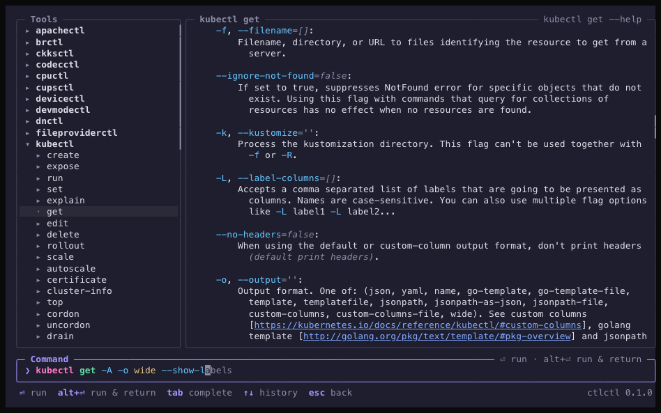

# `ctlctl` 🐄🐄

**A harness for your `*ctl` tools.**

`kubectl`, `systemctl`, `launchctl`, `journalctl`, `talosctl`, `istioctl`…
Each one has dozens of subcommands and hundreds of flags. ctlctl puts them all
in one view. Pick a tool and its subcommands from a tree, read
their `--help` with syntax highlighting, click flags into the command line,
then fill in the arguments and press Enter.



## Install

macOS, Linux and FreeBSD:

```sh
curl -fsSL https://raw.githubusercontent.com/rafalmaciejewski/ctlctl/main/install.sh | sh
```

Windows (PowerShell):

```powershell
irm https://raw.githubusercontent.com/rafalmaciejewski/ctlctl/main/install.ps1 | iex
```

For other ways to install, see [Installation](docs/installation.md).

## Usage

```sh
ctlctl              # every *ctl tool you can run
ctlctl kubectl get  # open a tool, or go straight to a subcommand
```

1. Select a tool and press Enter to see its subcommands.
2. Pick subcommands the same way. When you reach one without subcommands,
   Enter moves you to the command line, already holding something like
   `kubectl get `.
3. Type the arguments, clicking flags in the help to add them, and press
   Enter to run the command.

Press `?` to see all keys, and `ctrl+c` to quit.

## Docs

- [Usage](docs/usage.md): keys, mouse, running commands, shell integration
- [Configuration](docs/configuration.md): choosing which tools are listed
- [How it works](docs/how-it-works.md): finding tools, reading their help,
  and why subcommands are never run by accident
- [Installation](docs/installation.md): versions, install location, Go,
  manual downloads

## Contributing

See [CONTRIBUTING.md](CONTRIBUTING.md) for development and the release
process.

## License

[MIT](LICENSE)
